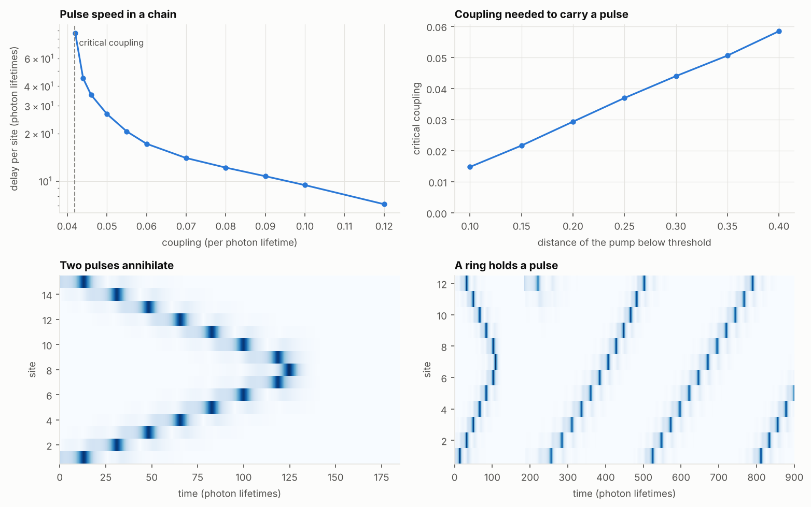

# PillarChain

Pulse propagation and collisions in networks of coupled excitable micropillar lasers, in Python with a Julia kernel. Each pillar is a laser with a saturable absorber that answers a strong enough perturbation with one pulse; coupled to its neighbours, it passes that pulse on. The package simulates chains, rings, junctions and lattices of such pillars and measures what the pulses do: how fast they travel, when they stop, how they annihilate, and how a junction of three chains turns into a coincidence gate.

The repository is also a library of 94 networks. Each file states in its first lines what it shows and what it is checked against, and carries the result as machine-checked expectations. Every network is integrated a second time by an independent route.

## What is inside

| Part | Where (`src/pillarchain`) | Content |
|---|---|---|
| Model | `model.py` | lasers, networks (links, paths, grids, per-site pumps), the coupled equations |
| Simulation | `simulate.py` | kicks, piecewise high-order integration, spikes located on the dense solution |
| Files | `casefile.py`, `expect.py`, `runner.py` | text format, thirteen kinds of expectation, command line |
| Library | `cases/*.pil` | 94 networks in ten families |
| Reference | `reference.py`, `compare.py` | the same equations in complex form with another integrator; closed form of the dark regime; fixed-step Runge-Kutta |
| Studies | `studies.py` | speed, critical coupling, refractory time, circulation in rings, junction truth table, symmetries, convergence |
| Julia kernel | `julia/PillarKernel` | the same model with its own fixed-step integrator; reads the same network files and checks their expectations |
| Results | `reports/cases/*.json`, `reports/figures/cases/*.png` | every case: spikes, checks, and a raster of intensity against site and time |

205 Python tests, of which 94 are the library's cases one by one.

## Results

94 networks, 993 pillars, 1,105 spikes, 2,146 checks, all passing. Full tables in `reports/report.md`.

| Family | Cases | What is verified |
|---|---|---|
| Single pillar | 15 | kick threshold, summation of two weak kicks, refractory time, irrelevance of the phase |
| Dark regime | 8 | weak kicks against the closed form from the eigenmodes of the coupled cavities, within 0.2% |
| Chains | 26 | propagation against coupling, pump, linewidth factor and carrier rate; strong coupling; long chains |
| Defects | 8 | one pillar pumped differently; one weak link |
| Collisions | 5 | annihilation, shifted meeting point, three pulses, opposite phases |
| Rings | 6 | two fronts annihilate; a second kick in the vulnerable window leaves a circulating pulse |
| Junctions | 13 | AND, coincidence window, interference, OR, fan-out |
| Lattices | 5 | fronts from a corner, the centre and two corners; a lattice below its critical coupling |
| Diode | 3 | a chain feeding a strip: blocked one way, open the other |
| Pulse trains | 5 | four kicks at five intervals |

Agreement with the independent integration over the library: spike times within 3.2e-3 photon lifetimes (7e-5 for a typical case, the largest in a strongly coupled chain), spike heights within 7e-6 relative, dark intensities within 1e-6.



## Eight things the networks show

1. **A chain carries a pulse only above a critical coupling.** For the default laser and a kick of amplitude 2 it is 0.04186 per photon lifetime. Just above it the pulse crawls (87 photon lifetimes per site at 0.042); at 0.06 it takes 17.2, at 0.12 7.1. Between 0.07 and 0.1 the delay times the coupling is close to 1.
2. **The critical coupling grows almost linearly with the distance of the pump below threshold**: 0.015 at 0.1 below, 0.044 at 0.3, 0.058 at 0.4 (kick of 2.5).
3. **Pulses that meet annihilate.** Launched from both ends of a chain of 15, they fire every pillar exactly once and nothing passes through; a late launch moves the meeting point. If the two kicks have opposite phases the middle pillar receives two cancelling fields and never fires.
4. **A ring remembers.** One kick sends a pulse each way round a ring of 12 and they annihilate. A second kick on the pillar behind the first, 185 photon lifetimes later, finds one neighbour recovered and the other still refractory: the new pulse can only go one way and circulates for the rest of the run. The same kick at 150 does nothing, at 230 it launches a second annihilating pair.
5. **The circulating pulse runs into its own wake.** In a ring of 12 the round trip takes 277 photon lifetimes, 1.34 times the delay per site of an open chain; in a ring of 20, 1.10 times; in a ring of 30, 1.02 times.
6. **A weak junction is a coincidence gate, and a phase-sensitive one.** With links of 0.03 into the junction one pulse is not enough and two in phase are; a lag of 5 photon lifetimes still fires it, 10 does not; opposite phases cancel. With links of 0.06 one pulse passes, two in phase pass, two in antiphase still cancel.
7. **Geometry makes a diode.** At a coupling of 0.043 a chain cannot fire the middle of a strip three pillars wide, while a front in the strip fires the chain. At 0.05 both directions pass: the window is narrow.
8. **Stronger coupling is not simply faster.** At 0.15 and above pillars fire more than once, and at 0.4 a kick of amplitude 2 spreads over the neighbours before it can fire anything.

## Reading the numbers

- The model is the Yamada rate equations with a complex field per pillar and conservative coupling between identical single-mode cavities. There is no noise, no spontaneous emission, no detuning between pillars, no carrier diffusion, no dissipative part of the coupling, no thermal effects. Real pillars have all of these; detuning and disorder in particular would weaken every interference effect listed above.
- Parameter values are typical ones for these lasers (B = 5.8, a = 1.8, gamma = 0.01, alpha = 2), not fitted to a device, and couplings are in units of the photon decay rate, not derived from a pillar geometry. Nothing here is compared with measurements.
- A kick is an instantaneous jump of the field. A real perturbation has a duration and a detuning; kick amplitudes here are not calibrated against pulse energies.
- Thresholds are sharp only because the model is deterministic. With noise the critical coupling, the vulnerable window and the coincidence window become probabilities. The numbers near them (the diode at 0.043, the weak link at 0.045, the chain at 0.042) are properties of these exact parameters.
- The critical coupling depends on how the pulse is launched: between 0.0418 and 0.0440 for kicks from 1.6 to 4, and not monotonically. The refractory time likewise runs from 88 to 205 photon lifetimes with the kick. Both are found by bisection assuming a single switch in the bracket.
- "Fires once" is counted with a fixed threshold of intensity 5, against pulse heights near 57. Some cases produce a second spike on a kicked pillar (the centre of the 7 by 7 lattice, one pillar of the strip); the files say so.
- The gates are demonstrations on one junction geometry. Nothing is said about cascading them, fan-in beyond two, or tolerance to parameter spread.
- The independent integration shares the equations with the package, as it must, and shares SciPy, but none of the package's code. It verifies the numerics, not the model.
- The Julia kernel is a small port with a fixed-step integrator. Its tests are run by the CI workflow.

## Run it

```
make install        # pip install -e ".[dev]"
make test           # unit tests and the 94 cases
make run            # simulate the library, write reports/
make julia-test     # tests of the Julia kernel

python -m pillarchain check cases/junction_and_both.pil
python scripts/chain.py --sites 10 --kappa 0.05
python scripts/critical.py --pump 6.6
python scripts/plot_case.py cases/ring_second_kick185.pil ring.png
```

`python -m pillarchain run --fast` simulates a subset in under a minute.

## A network file

```
# Two input arms (sites 1 to 5 and 6 to 10) meet at site 11; the output arm runs from 11 to 16.
title Weak junction, both inputs together: AND
sites 16
path 1 5 kappa=0.06
path 6 10 kappa=0.06
path 11 16 kappa=0.06
link 5 11 kappa=0.03
link 10 11 kappa=0.03
kick 1 amplitude=2
kick 6 amplitude=2
run 1200
expect each 1 16 1
expect arrival 16 184.14538 0.003
```

The format is described in `docs/network_files.md`, the model and the checks in `docs/methodology.md`.

## Layout

```
src/pillarchain/      package
cases/                94 network files
julia/PillarKernel/   Julia kernel and its tests
tests/                unit tests, one test per case, fast pipeline
scripts/              small command-line tools
configs/default.yaml  families, studies, overview
reports/              report.md, validation.md, metrics.json, per-case records and figures
docs/                 methodology, file format
```

## Author

Amir Masominia. PhD in physics (Université Paris-Saclay); postdoctoral researcher working on machine-learning surrogate models, numerical simulation and automated measurement pipelines.

MIT licence.
